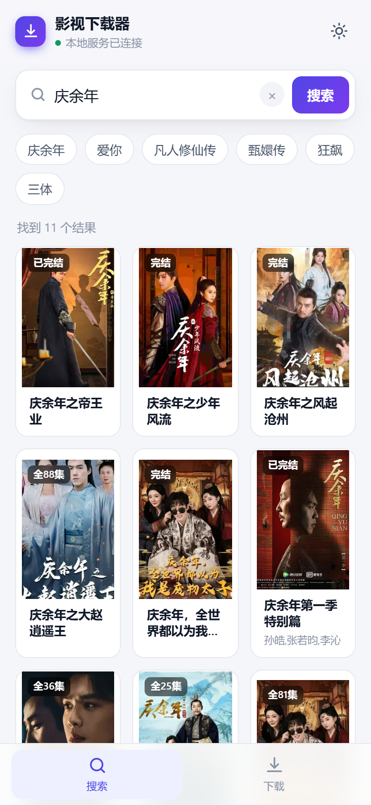
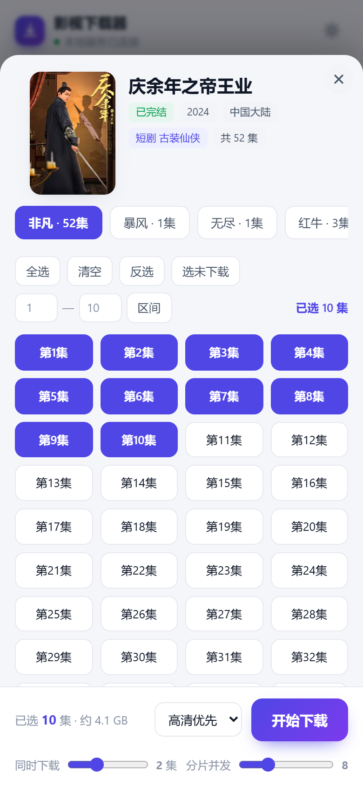
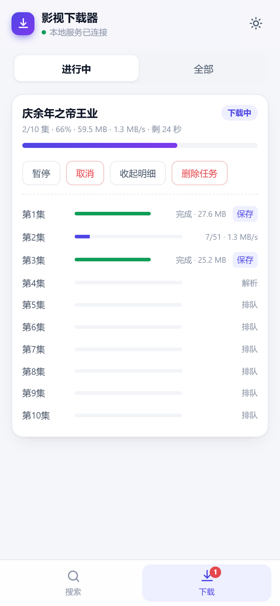
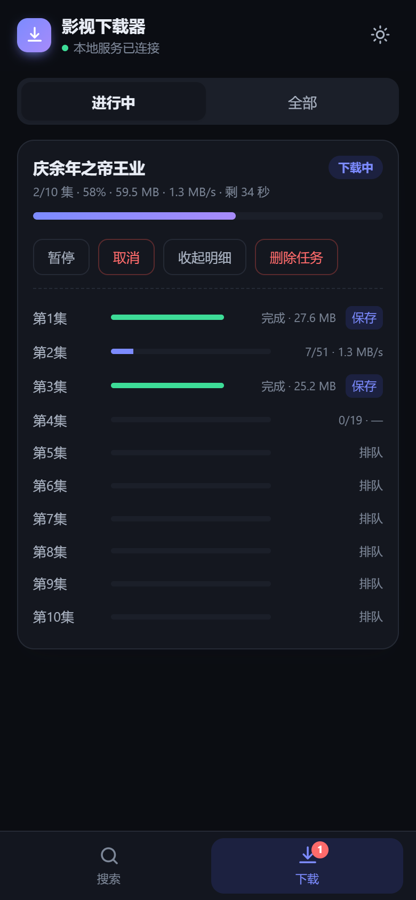
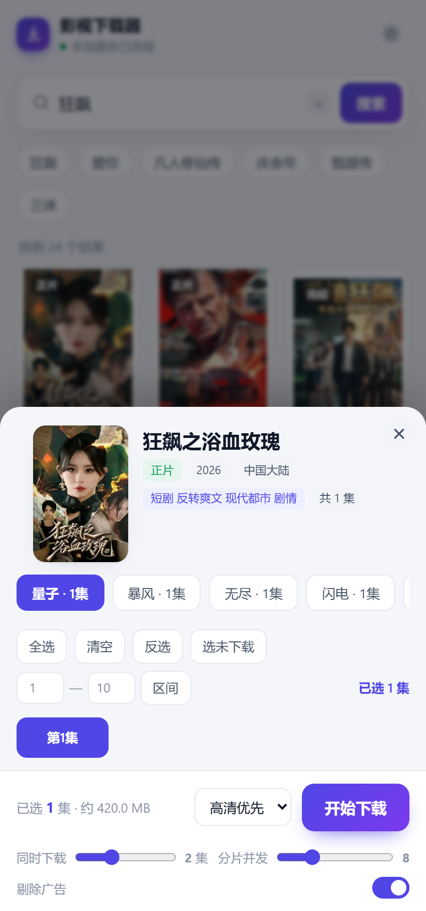

# 影视下载器 · Android

把 [nodejs-mobile](https://github.com/nodejs-mobile/nodejs-mobile) 塞进 APK：App 启动时在**手机本地**拉起一个
Node 服务（`127.0.0.1:8787`），内置 WebView 打开界面。下载、解析、任务管理全部在手机上跑，
不依赖电脑、不依赖任何外部服务器。

- 搜索剧名 → 选线路 → 勾选分集 → 批量下载
- 前台服务保活：切后台、锁屏、划掉任务卡片都能继续下
- 多集并行、分片并发、断点续传、暂停/继续/重试
- **自动剔除正片中间插播的广告**（不影响时间轴，播放不卡顿、不音画不同步）
- 每集下完**自动**保存到 `下载/VodBox/<剧名>/`，一部剧一个文件夹

| 搜索 | 选集 | 下载 | 深色模式 |
|---|---|---|---|
|  |  |  |  |

<p align="center">
  
  <br>
  <sub>选集面板底部的「剔除广告」开关，默认开启</sub>
</p>

---

## 一、架构

```
┌──────────────────┐   同源 HTTP   ┌──────────────────────────────┐  HTTPS  ┌────────────────┐
│ WebView / 浏览器  │ ←──────────→ │ 本地 Node 服务 127.0.0.1:8787 │ ←─────→ │ 站点页面 / CDN │
│      界面 UI      │               │ 搜索·详情·解析·下载·任务管理   │         │                │
└──────────────────┘               └──────────────────────────────┘         └────────────────┘
                                             ↑ 宿主
                              ┌──────────────────────────────────┐
                              │ DownloadService（安卓前台服务）    │
                              │ Node 运行时 · 导出线程 · 通知 · 锁 │
                              └──────────────────────────────────┘
```

三条硬约束决定了整个设计：

**1. 必须有自己的网络层，纯前端方案不可行。**
站方的中间接口（搜索、详情、播放地址）不返回 CORS 头，浏览器直连一律被同源策略拦；
只有最终 CDN 分片带 `Access-Control-Allow-Origin`。所以页面只跟 `127.0.0.1` 通信，
所有跨域请求由本地 Node 代劳。

**2. 播放地址不自己逆向，直接跑站方脚本。**
站方播放脚本经过混淆且会更新，硬解必然频繁失效。`lib/resolver.js` 用 Node `vm` 建沙箱，
喂进假的 jQuery / DOM，原样执行站方脚本，拦截它自己的 ajax，从 `iframe.src` 里取出真实 m3u8。
站方改版时只需 `POST /api/refresh` 重新拉一次脚本，不用改代码。

**3. 下载与保存必须在安卓前台服务里。**
安卓会在 App 切后台后冻结普通进程的线程。Node 运行时、任务调度、文件导出全部挂在
`DownloadService`（`foregroundServiceType="dataSync"`）里，配 `PARTIAL_WAKE_LOCK` +
`WIFI_MODE_FULL_HIGH_PERF` + 常驻通知，Activity 只负责画界面。
手机端只绑回环地址（桌面端才绑 `0.0.0.0`），同一 WiFi 的其它设备访问不到。

---

## 二、一条下载的生命周期

```
搜索 /api/search ──→ 详情 /api/detail ──→ 创建任务 /api/download
                                                    │
                                    ┌───────────────┴────────────────┐
                                    │  lib/jobs.js 分集并行调度        │
                                    └───────────────┬────────────────┘
                                                    ↓
        ┌───────────────────────────────────────────────────────────────┐
        │ lib/resolver.js  沙箱跑站方脚本 → 真实 m3u8                     │
        │ lib/hls.js       解析播放列表 → 分片并发下载 → 单写者异步落盘     │
        │ lib/ads.js       断点切块 + 流参数指纹 → 丢掉广告段               │
        └───────────────────────────────┬───────────────────────────────┘
                                        ↓  私有目录 downloads/<剧名>/<集名>.ts
        ┌───────────────────────────────────────────────────────────────┐
        │ DownloadService 的 export-pump 线程轮询 /api/export/next        │
        │ → 直接读私有文件 → MediaStore 写入 下载/VodBox/<剧名>/           │
        │ → 回报 /api/export/done → 删掉中转文件（省一半空间）              │
        └───────────────────────────────────────────────────────────────┘
```

**保存这块的设计要点**（`lib/jobs.js` 的导出状态机 + `DownloadService` 的搬运线程）：

- Node 没法反向调 Java，所以由 Java 轮询本地 HTTP 接口取「下一个待导出文件」；
- 搬运时直接读 App 私有目录的文件，不走回环 HTTP 复制，省一次全量传输；
- 导出成功才删中转文件；同名成品已存在则跳过，不会产生 `xxx(1).ts`；
- 失败累计 3 次置 `exportFailed`，界面出现「重试保存」，避免无限重试；
- 状态持久化在 `data/jobs.json`，App 被杀重启后能接着搬。

---

## 三、模块职责

| 文件 | 职责 |
|---|---|
| `config.js` | 站点地址与全部可调参数，**唯一配置点** |
| `server.js` | HTTP API + SSE 进度推送 + 封面代理 + 静态文件 |
| `lib/http.js` | keep-alive 连接池、重试、Cookie、超时 |
| `lib/parser.js` | 搜索页 / 详情页解析、标题清洗 |
| `lib/resolver.js` | `vm` 沙箱执行站方脚本，解析真实 m3u8 |
| `lib/hls.js` | m3u8 解析、有界窗口并发、单写者异步写盘、断点续传 |
| `lib/ads.js` | 广告块识别（断点切块 + 流参数指纹） |
| `lib/tsinfo.js` | MPEG-TS 解析（PAT/PMT/SPS/PTS） |
| `lib/jobs.js` | 任务队列、分集并行、持久化、导出状态机 |
| `public/index.html` | 界面（零依赖单文件） |
| `MainActivity.java` | WebView 容器 + JS 桥 + assets 版本化拷贝 |
| `DownloadService.java` | 前台服务：Node 运行时、导出线程、通知、锁 |
| `NodeRunner.java` / `native-lib.cpp` | JNI 入口 `node::Start` |
| `tools/gen-icon.py` | 生成 App 图标（改配色/造型后重跑） |

---

## 四、广告剔除

站方会在正片中间塞一两段广告。现象是播放器播到广告处卡在「解析中」，之后音画不同步。

原因是广告段来自**另一条编码链**（实测：正片 720×1280@L3.1，广告 1920×1080@L4.0），
且 PTS 从 0 重新计时。直接拼进同一个 `.ts`，播放器遇到 SPS 突变 + PTS 回退 296 秒，
只能重新初始化解码器，音视频重建就不同步了。

关键性质：正片两侧的 PTS 本来是连着的，所以**只要把广告段整段丢掉，剩下的时间轴天然连续**，
不需要重写 PTS/PCR。

识别方式：

1. `#EXT-X-DISCONTINUITY` 把播放列表切成若干块；
2. 对每个**短块**（≤180 秒）用 HTTP Range 只取首片前 64KB，解析 PAT/PMT/H.264 SPS，
   得到「流参数指纹」（分辨率 / profile-level / 音频参数 / PID 集合）与首帧 PTS；
3. 两条**同时成立**才判广告：指纹与基准块（最长的块）不同 **且** 首帧 PTS < 12 秒。

取交集是为了防误伤——真正的「上下部拼接」PTS 也从 0 开始，但编码参数一致，能被保住。
安全阀：基准探测失败就不删；剔除比例超过 50% 判定误判，全部保留。**宁可留广告，不删正片。**

剔除方案会写进 `.part.json`，续传时直接复用，不会因为探测结果抖动导致断点失效。

---

## 五、目录结构

```
.
├── build.gradle / settings.gradle / gradle.properties
├── app/
│   ├── build.gradle                    AGP / minSdk 24 / targetSdk 34
│   ├── CMakeLists.txt                  导入 libnode.so + 编译 JNI 桥
│   ├── proguard-rules.pro
│   └── src/main/
│       ├── AndroidManifest.xml
│       ├── res/mipmap-*/               图标（含自适应图标，脚本生成）
│       ├── cpp/native-lib.cpp          JNI：node::Start
│       ├── java/com/vodbox/downloader/
│       │   ├── MainActivity.java
│       │   ├── DownloadService.java
│       │   ├── NodeRunner.java
│       │   └── MediaStoreHelper.java
│       └── assets/nodejs-project/      Node 服务 + 前端（电脑上也能直接跑）
├── tools/gen-icon.py                   图标生成脚本
├── docs/screens/                       README 截图
└── .github/workflows/build.yml         GitHub Actions
```

`app/libnode/` 由 CI 自动下载填充，**不需要手动放任何 .so**。

---

## 六、构建

### 云构建（推荐，本地零安装）

1. 把本目录 push 到 GitHub 仓库（public / private 均可）。
2. 进 **Actions** → `Build APK`，自动触发（也可 Run workflow）。
3. 等 3–8 分钟，在 **Artifacts** 下载 `app-debug-apk`（内含 `app-debug.apk`）。
4. 手机安装，允许「未知来源」即可。debug 签名个人使用足够。

> 构建必须在 GitHub 上跑，本地需要 Android SDK + NDK + nodejs-mobile 二进制。

### 正式签名版（可选）

1. 生成密钥：
   ```bash
   keytool -genkey -v -keystore vodbox.keystore -alias vodbox \
     -keyalg RSA -keysize 2048 -validity 10000
   ```
2. 仓库 **Settings → Secrets → Actions** 增加：`KEYSTORE_BASE64`（`base64 -w0 vodbox.keystore`）、
   `KEY_ALIAS`、`KEY_PASSWORD`、`STORE_PASSWORD`。
3. 取消 `build.yml` 末尾 release 段注释，补一段解码密钥的步骤。
4. 重新 Run workflow，下载 `app-release.apk`。

### 电脑上直接跑（调试最方便）

```bash
cd app/src/main/assets/nodejs-project
node server.js            # 浏览器打开 http://localhost:8787
PORT=9000 node server.js  # 换端口
```

电脑端默认绑 `0.0.0.0`，同一 WiFi 的手机可直接访问 `http://<电脑IP>:8787`。

### 包体积（17MB，怎么再调）

APK 里绝大部分体积就是 `libnode.so`——nodejs-mobile 把整个 Node 运行时打成**一个 so**。
实测（v18.20.4，AGP 打包时会 strip 掉调试符号）：

| ABI | 原始 so | strip 后 | 压缩进包 |
|---|---|---|---|
| `arm64-v8a` | 59.6 MB | 47.2 MB | **16.1 MB** |
| `armeabi-v7a` | 56.0 MB | 44.4 MB | 15.1 MB |
| `x86_64` | 62.3 MB | 49.4 MB | 16.8 MB |

所以体积只由两个旋钮决定，别处优化收益都可以忽略：

| 旋钮 | 位置 | 现状 | 影响 |
|---|---|---|---|
| `vodAbiFilters` | `gradle.properties` | `arm64-v8a` | 每多打一个 ABI **+16MB**（压缩后） |
| `useLegacyPackaging` | `app/build.gradle` | `true` | 不开的话 so **直存**，一个 ABI 就 47MB |

- **只打 arm64-v8a**：2018 年后的在售机型基本全是 64 位，够用。要兼容 32 位老设备改成
  `vodAbiFilters=arm64-v8a,armeabi-v7a`，APK 约 33MB。x86/x86_64 只有模拟器要，不要加。
- **`useLegacyPackaging = true`** 让 so **压缩**进包（AGP 8 默认 `false` = 未压缩直存）。
  这一项是 143MB → 17MB 的关键：三个 ABI 直存就是 141MB，压缩后三个也才 48MB。
  代价是**安装时由系统把 so 解压到 App 的原生库目录**（路径不是 `/data/app/<pkg>/lib`，而是
  `/data/app/~~<随机串>==/<pkg>-<随机串>==/lib/arm64/`，Android 10+ 还会变，**普通文件管理器看不到，要 root 或 adb**）。
  查真实路径：`adb shell dumpsys package com.vodbox.downloader | grep -iE 'codePath|nativeLibrary|primaryCpuAbi'`。
  解压后 so 仍是 47MB，所以**安装后总占用 = APK 17MB + 解压出来的 ~49MB ≈ 66MB**（比旧包 143MB 还是小一半多）；
  首次安装会慢几秒。不要给 Manifest 手写 `android:extractNativeLibs="false"`，会把这条配置顶掉导致运行时找不到 so。
- CI 的 `Resolve ABI list` 步骤会把 `vodAbiFilters` 与 nodejs-mobile 实际提供的 ABI **取交集**
  再写回 `gradle.properties`（防止某个 ABI 不存在导致构建失败）；`Report APK size` 步骤把
  APK 本体大小、内含 ABI、每个 so 的压缩方式写进 run 页面的 Summary 和一条 annotation。
- `minifyEnabled` 不值得开：Java 侧就几个类，省不到 1MB，反而要维护 proguard 规则。

---

## 七、配置

全部参数在 `config.js`，也支持环境变量覆盖：

| 变量 | 默认 | 说明 |
|---|---|---|
| `PORT` | 8787 | 端口 |
| `APP_BIND` | 安卓 `127.0.0.1` / 桌面 `0.0.0.0` | 监听地址 |
| `APP_SITE` | 内置站点 | 站点地址（唯一配置点） |
| `APP_EP_CONC` | 2 | 同时下载几集（1–4） |
| `APP_SEG_CONC` | 8 | 单集分片并发（2–24） |
| `APP_MAX_SOCKETS` | 32 | 全局连接上限 |
| `APP_STRIP_ADS` | 1 | 剔除插播广告（0 关闭） |
| `APP_EXPORT_AUTO` | 1 | 下完自动导出到系统下载目录 |
| `APP_EXPORT_DELETE_LOCAL` | 1 | 导出成功后删掉私有目录的中转文件 |

---

## 八、接口

| 接口 | 说明 |
|---|---|
| `GET /api/search?kw=` | 搜索（缓存 + 重试 + 多域名兜底） |
| `GET /api/detail?vid=` | 剧集信息 + 线路 + 分集 |
| `POST /api/resolve` | 批量解析真实 m3u8 |
| `POST /api/download` | 创建下载任务 |
| `GET /api/jobs` | 任务列表与进度 |
| `GET /api/events` | SSE 实时推送 |
| `POST /api/job/:id/{pause,resume,cancel,retry}` | 任务控制 |
| `DELETE /api/job/:id?files=1` | 删除任务（可选删文件） |
| `GET /api/export/next` | 取下一个待导出的文件（安卓端轮询） |
| `POST /api/export/done` | 回报导出结果 |
| `POST /api/export/retry` | 重新排队导出 |
| `GET /api/file/:jobId/:idx` | 取回成片（支持 Range） |
| `GET /api/img?u=` | 封面代理（带 Referer + 缓存） |
| `POST /api/refresh` | 重新拉取解析脚本 |
| `GET /api/info` | 服务信息 |

---

## 九、常见问题

**改了前端/服务端代码，装了新 APK 却没变化？**
`assets` 只在首次安装时拷到私有目录。改完 `assets/nodejs-project/**` 里的任何文件，
必须把 `MainActivity.ASSET_VERSION` 加 1，App 升级时才会重新拷贝
（会保留 `downloads/`、`data/`、`cache/`）。

**下载的文件在哪？**
系统「下载/VodBox/**剧名**/第01集.ts」。App 私有目录 `downloads/<剧名>/` 只是中转，
导出成功后自动清理，不会占双倍空间。

**卸载后手机上会残留什么？**
只剩系统「下载/VodBox/」里的成品——那是公共目录里的用户文件，卸载不会动（要清就手动删）。
`/data/app/~~xxx==/<pkg>-xxx==/`（APK + 解压出来的 so）和 `/data/data/<pkg>/`（中转文件、
`jobs.json`、搜索历史、WebView 缓存）都会被系统整目录删掉，前台服务和常驻通知随进程消失。
备份也已关掉：`allowBackup="false"` + `res/xml/data_extraction_rules.xml`（Android 12+ 上
`allowBackup=false` 只禁云备份、不禁设备间迁移，必须两个通道都排除），所以重装不会恢复旧任务。

**下载不动 / 很慢？**
先把「同时下载」调到 2–3 集；分片并发 8–12 即可。弱网会自动重试，中断后再点下载会从断点续传。

**播到中间卡住、音画不同步？**
保持「剔除广告」开关打开。已经下好的旧文件不会自动修好，需要重新下载一次。

**站方改版导致解析失败？**
`POST /api/refresh` 会重新拉取播放脚本；连续失败时服务端也会自动重新拉取。

---

## 十、构建踩坑（改构建文件前先看，别回退）

| # | 现象 | 根因 | 修复 |
|---|---|---|---|
| 1 | `setup-android@v3` 报 `Failed to find package 'tools'` | 该 action 过时 | 删掉，用运行机预装 SDK |
| 2 | `Could not find method abiFilters()` | Gradle DSL 里它是**属性** | `abiFilters = [...]` 赋值 |
| 3 | `Cannot find source file: native-lib.cpp` | CMakeLists 在 `app/`，源码在 `src/main/cpp/` | 写相对路径 `src/main/cpp/native-lib.cpp` |
| 4 | lambda 里引用局部变量报错 | 变量被重新赋值 | 加 `final` 副本 |
| 5 | ninja: `libnode.so missing` | CMake 路径多一层 `../` | `${CMAKE_SOURCE_DIR}/libnode/lib/${ANDROID_ABI}/libnode.so` |
| 6 | 运行时 `UnsatisfiedLinkError` | 只链接没打包 | `jniLibs.srcDirs += ['libnode/lib']` |
| 7 | `Unexpected character: '#'` | Groovy 注释不是 `#` | 用 `//` |
| 8 | CI 解压依赖 zip 内部结构 | 官方包结构会变 | `find` 定位后重排 |
| 9 | 某些 ABI 缺 so | nodejs-mobile 只提供部分 ABI | CI 拿 `vodAbiFilters` 与可用 ABI **取交集**（不要直接覆盖成全量，否则体积优化失效） |
| 10 | APK 突然变 140MB | `abiFilters` 被打成 3 个 ABI + so 未压缩直存 | 只留 `arm64-v8a` + 开 `useLegacyPackaging`，见「包体积」 |
| 11 | 装了打不开 / 找不到 libnode.so | Manifest 写了 `extractNativeLibs="false"` 与压缩打包冲突 | 删掉该属性，交给 `useLegacyPackaging` 决定 |

改 `CMakeLists.txt` / `native-lib.cpp` / `System.loadLibrary` 时，库名 `vodbox` 和符号
`Java_com_vodbox_downloader_NodeRunner_start` 三处必须同步。

---

## 十一、说明

- 仅作技术研究与离线收藏用途，请勿传播受版权保护的内容。
- 输出为标准 MPEG-TS（`.ts`），PotPlayer / VLC / nPlayer 可直接播放；
  转 mp4：`ffmpeg -i 第1集.ts -c copy 第1集.mp4`
- 图标由 `python tools/gen-icon.py` 生成，改 `PALETTE`（配色）或 `ARROW`（造型）后重跑即可。
